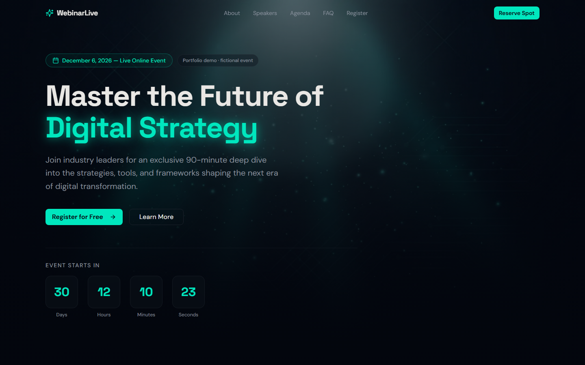
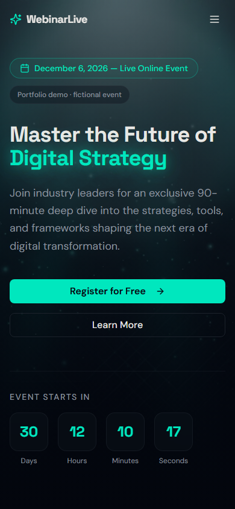

# WebinarLive: Webinar Landing Page

A responsive, one-page landing page for a (fictional) live webinar, built with **React 19, TypeScript,
Tailwind CSS 4 and Framer Motion**. It is a front-end design demo: a dark "Midnight Studio" visual style, scroll
animations, a live countdown and a validated registration form.

> **Demo content.** The event, speakers, companies, testimonials and headshots (AI-generated images) are
> fictional. The registration form has no backend: input is validated in the browser and nothing is sent or
> stored. The page says this on screen as well.



<p align="center"></p>

## Features

- **Hero with live countdown.** The fictional event is always scheduled 30 days ahead at 2:00 PM US Eastern
  Time (DST-aware via `Intl`), so the countdown never sits at zero.
- **About, Speakers, Agenda timeline, Highlights, Testimonials, Audience and FAQ sections.**
- **Registration form** with required-field and e-mail validation, a loading state and a success state
  (simulated, clearly labelled).
- **Responsive navigation** with a mobile menu, smooth scrolling and a scroll-to-top button.
- **Accessibility details:** `aria-expanded` on the menu and FAQ toggles, screen-reader text for star ratings,
  descriptive `alt` text, zoom not disabled.
- **Self-contained assets:** all images are served from `client/public/images`, with no external CDN.

## Tech stack

| Area | Tools |
|---|---|
| UI | React 19, TypeScript 5.6, Tailwind CSS 4, shadcn/ui (Radix primitives), lucide-react |
| Motion | Framer Motion |
| Build | Vite 7, pnpm |
| Serving | Static build; optional minimal Express server (`server/index.ts`) for SPA routing |

## Getting started

Requires Node.js 20+ and pnpm (`corepack enable` or `npx pnpm@10.4.1`).

```bash
pnpm install
pnpm dev        # http://localhost:3000
pnpm check      # TypeScript type-check
pnpm build      # static site -> dist/public, server -> dist/index.js
pnpm preview    # serve the production build locally
```

The build uses a relative base path, so `dist/public` can be hosted from any static host or sub-path
(for example GitHub Pages).

## Project structure

```
client/
  index.html            page shell, meta tags, fonts
  public/images/        hero, section and speaker images (.webp)
  src/pages/Home.tsx    all landing-page sections
  src/components/ui/    shadcn/ui components
  src/index.css         design tokens (colours, fonts, glow utilities)
server/index.ts         optional Express static server
docs/design-notes.md    the three design directions considered and why "Midnight Studio" was chosen
```

## How it was built

The first version was generated with the [Manus](https://manus.im) AI agent (visible in the commit history).
I then reviewed and refined it:

- moved all images into the repository instead of hot-linking an external CDN;
- replaced the fixed, already-past event date (which left the countdown at 00:00) with a rolling demo date and
  corrected the time zone label (EST to ET);
- made the agenda consistent with the advertised 90 minutes (the original slots added up to 120 minutes);
- labelled fictional speakers, testimonials and the simulated form honestly, and removed invented credentials
  that named real companies;
- removed unused scaffolding (Maps/OAuth helpers, the agent's debug log collector, an unconfigured analytics tag)
  and limited the dev server to `localhost`;
- added accessibility attributes, meta tags, a favicon, screenshots and this README.

## Verification

Verified locally on 2026-11-06: `pnpm check` (0 TypeScript errors), `pnpm build` (success), and a visual review
of the production build in headless Microsoft Edge at 1440x900 and 390x844 with no console errors. There are no
automated UI tests.

## License

[MIT](LICENSE)
